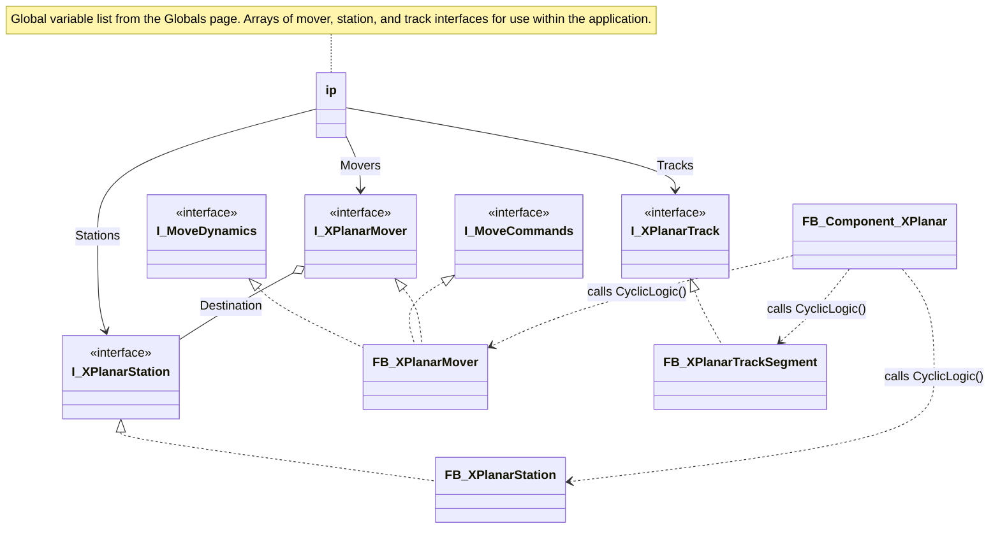
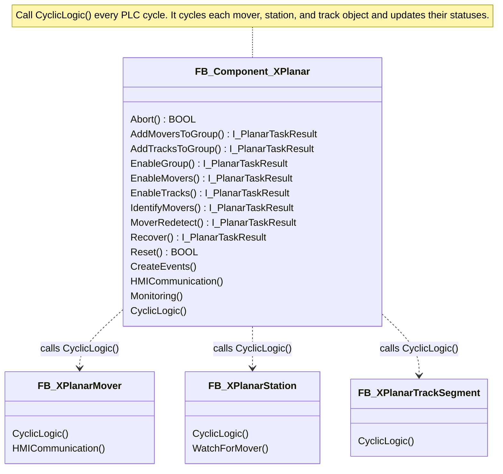
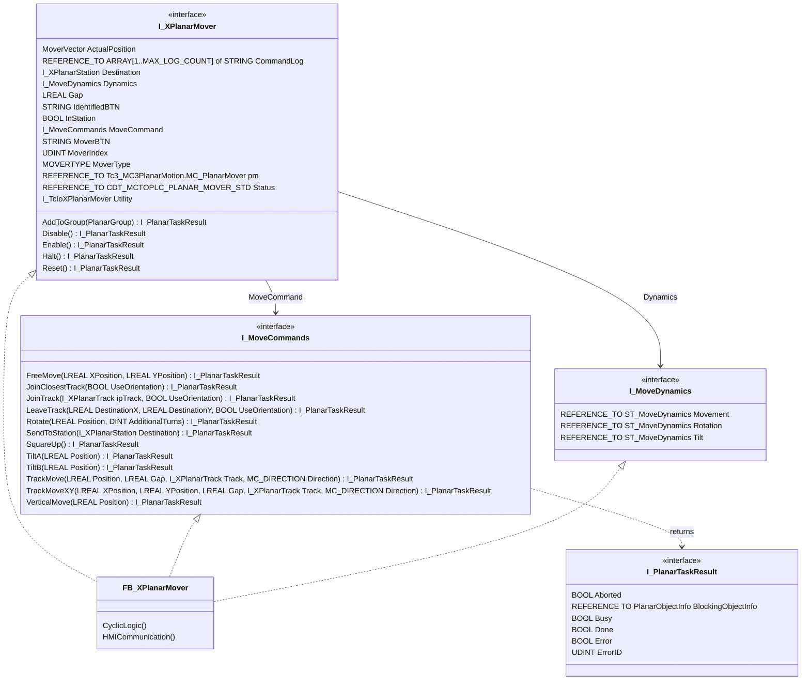
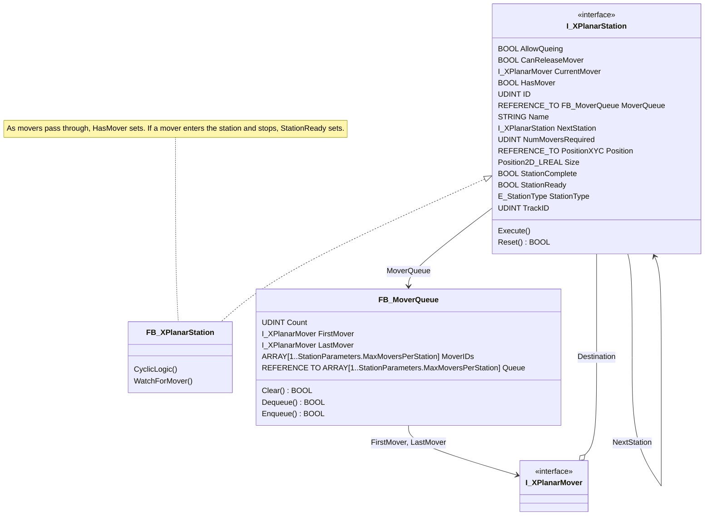
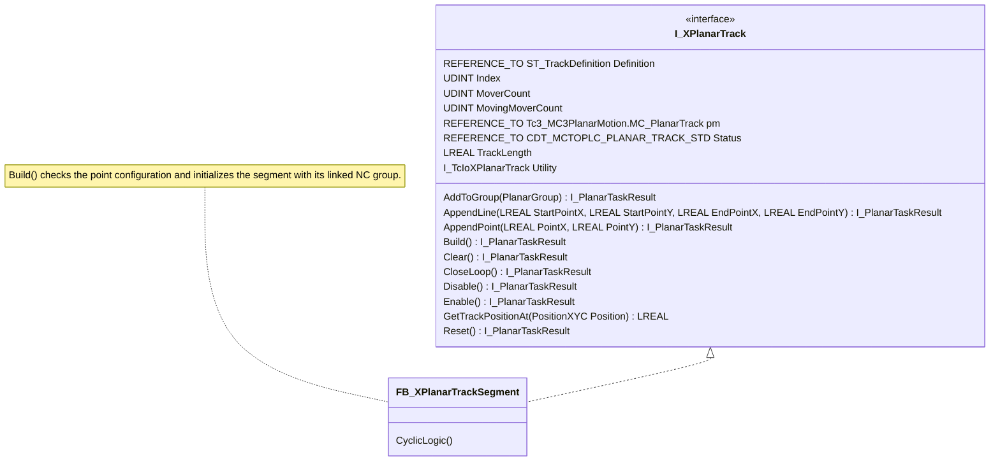

# Overview
A modular XPlanar control component function block with minimal overhead built on the Planar Motion and XPlanar Utility TF5890 libraries that can easily scale to custom and larger projects.  This function block can be used within the SPT Framework or any other architecture.

## Class Diagrams
The library splits into an overview and four subsystem diagrams. Full member tables with descriptions and access levels are on the [Function Blocks](./functionblocks.md) and [Interfaces](./interfaces.md) pages.

### Overview

### Component

### Mover

### Station

### Track Segment

