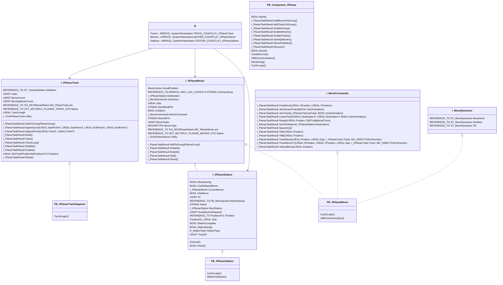

# Overview
A modular XPlanar control component function block with minimal overhead built on the Planar Motion and XPlanar Utility TF5890 libraries that can easily scale to custom and larger projects.  This function block can be used within the SPT framework or any other architecture.

## Class Diagram

